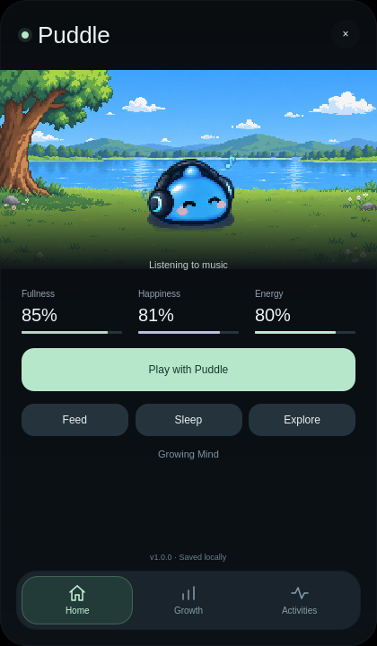
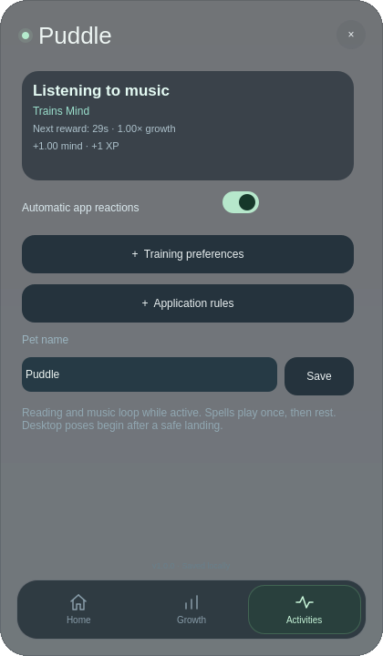

# Omachi Pet v1.0.0

A small desktop companion for Omarchy. Name your Egg, help it hatch into a Slime, take care of it, and let it explore your desktop. Your daily activities can shape its attributes and reactions.

**This plugin is still at v1 and is a work in progress.** I plan to keep improving it with bug fixes, smoother movement, better animations and new features. There may still be rough edges, and feedback, ideas and contributions are welcome.

The current version is single-player: it includes local saves, Egg → Slime hatching, hover-powered mana charging, care controls, activity-based XP, and a taskbar sprite you can place on the left, middle or right. **Bluetooth and multiplayer are future ideas, not available in v1.**

Publication status: this v1.0 build is being prepared for release; it has not yet been submitted to the Omarchy marketplace. Automated checks have passed, while live-desktop acceptance remains pending.




## Upgrade or install

Extract `omachi-pet-v1.0.0.zip`. Open a terminal inside the extracted `omachi-pet` folder and run:

```bash
bash install.sh
```

In a terminal, the installer asks whether to put the pet on the **Left, Middle, or Right** of the taskbar. Press Enter to keep an existing position, or use Right for a new installation. You can also specify a position directly: `bash install.sh --section middle` (or `left` / `right`).

The script detects whether Omachi Pet is already installed: if found it updates with a backup; otherwise it performs a fresh install without trying to disable a missing plugin. It validates the plugin, backs up an existing installation outside the plugin discovery folder, and enables v1.0.0. It restores the previous plugin if replacement fails. The script never edits or deletes pet saves. The installer restarts the Omarchy shell to release old UI code; the bar briefly disappears. Confirm `v1.0.0` in the Home footer or naming screen.

Your existing v0.7 pet loads directly from `pet-v7.json`; this release keeps the compatible save format and derives levels from existing growth. If no v7 save exists, the v0.5 save is migrated without changing the original. Name, stage, XP, needs, sleep and growth are retained. Legacy Calm is shown on Attributes.

Requires an Omarchy shell supporting schemaVersion 1 service/bar-widget plugins and Quickshell with Wayland IdleMonitor, Hyprland and MPRIS support. Runtime uses standard `mkdir`; Node, Python and Pillow are only needed for development/tests. Installation uses standard shell utilities.

## Remove

Use Omarchy's built-in removal command and confirm its prompt:

```bash
omarchy plugin remove community.omachi-pet
```

This removes the plugin without deleting your pet save at `~/.local/state/omachi-pet` (or `$XDG_STATE_HOME/omachi-pet`). Installation backups remain under `~/.local/share/omachi-pet/plugin-backups` (or `$XDG_DATA_HOME`). Reinstalling resumes the saved pet. The separate reset helper creates a save backup before starting a new Egg.

## Home

- **Feed** replenishes fullness and plays the supplied eating sheet. It has a 20-second cooldown.
- **Sleep / Wake** plays the sleep-entry, sleeping-loop and wake-up sheets. Very low energy causes automatic sleep; the pet wakes only after its minimum rest duration and at least 90 energy.
- **Go explore / Come home** uses the supplied vortex sequence across the room and desktop. Recall waits until a safe surface if the pet is airborne or climbing.
- **Play** gives 5 happiness and 0.3 affection, costs 2 energy, and has a 30-second cooldown.
- Clicking the pet gives affection with a 15-second cooldown. The supplied Happy animation plays when petting and after feeding or playing.

The bar shows only the current stage's sprite: Egg before hatching, Slime afterward. Clicking it opens the room. Growth beyond Stage 1 is reserved for a later release.

## Activities and attributes

The **Attributes** tab has five independent XP bars and level badges: **Mind, Power, Creativity, Charisma, Adventure**. Each begins at level 1. Reaching level 2 costs 25 XP, the next level costs 35 XP, then 45 XP, and so on. Existing lifetime growth is XP; no progress is reset. Bars show XP earned within the current level, not the balance between attributes. The actively trained attribute is highlighted.

The **Activities** tab contains detection, training targets, automatic reactions and application rules, keeping settings separate from your pet's progress.

Scroll down to **Activity training** and choose a target for each activity. For example, map Music → Mind: the pet keeps its music animation and normal happiness gain while earning Mind. Gaming defaults to Adventure + Power; selecting a target puts the total growth into that attribute. **Default** restores the activity's original allocation.

Further down, **Application rules** lets you assign a known or unfamiliar application class to an activity. Type the class, or choose **Use focused app**, then select a category. The selection saves immediately. Choose Automatic to remove a custom rule. Unknown apps have a general reaction and small care effects; they earn no attribute growth until classified. Browser windows default to Browsing, because the plugin does not inspect page titles or contents.

Activity is detected from local application class plus MPRIS playback. Reading/writing/coding use reading poses; playing media uses the music poses; gaming plays a complete spell occasionally, rotating five elements with a pause between casts. Music in the background adds a small happiness bonus during another recognized activity. MPRIS indicates media playback, so video playback may also be treated as music.

Rewards require **30 continuous eligible seconds** of an activity. Switching activity, sleep, manual care, travel or inactivity resets that interval. Five minutes without input stops activity growth, even if music continues. Elapsed time while suspended/offline does not earn activity XP. App reactions can be switched off on the Activities tab.

## Fatigue and care

Fullness, Energy, Happiness, Health and Affection are care stats, separate from lifetime attributes and XP. Activity costs energy and food. Growth slows at energy thresholds 70, 40 and 20; low food further reduces it. At energy 5 or lower intensive training stops, and at 2 or lower the pet sleeps (returning home first when roaming). Activities also accumulate tiredness. Sleep recovers 5 energy per 30 seconds and reduces tiredness; minimum rest ranges from one to ten minutes based on energy and fatigue. You can wake the pet manually. Health changes slowly when several needs remain poor. Affection comes from care, petting and occasional recall, never passive app activity. There is no death or multiplayer in this release.

## Artwork and known limits

Original supplied sheets are preserved under `art/source`; runtime crops, hashes and scales are recorded in `art/crops.json`. The latest import replaces walking with five frames and Happy with ten frames, and adds both mana Egg animations. Some other emotions and activities retain explicit related-pose fallbacks. No new original artwork is claimed.

Live compositor climbing, fullscreen hiding and mixed-monitor behavior still need verification after installation. Isolated Quickshell tests cover the controller, UI, saves, activities, travel and hatching; they do not replace a live-desktop test.

## Mini roadmap: the road to v2

This is the direction I would like to take the project. The milestones may change as I test things and hear your feedback; there are no fixed release dates yet.

| Milestone | Focus |
| --- | --- |
| **v1.1 — A more reliable companion** | Improve installation and updates, fix roaming/climbing issues, and test more desktop and monitor setups. |
| **v1.2 — More personality** | Refine activity reactions, add animations and make happiness, energy and care feedback easier to understand. |
| **v1.3 — Make it yours** | Expand customization and settings, improve save management, and explore more pet growth and evolution. |
| **v1.x — Connection experiments** | Prototype an optional way for nearby players to connect, exploring Bluetooth for discovery or pairing and testing what connection method works reliably. |
| **v2 — Friends and multiplayer** | Aim for opt-in pet visits and interactions between players, with shared activities or small games to explore together. |

The Bluetooth idea is to let nearby owners find each other and invite their pets to meet. Whether Bluetooth carries the connection itself or helps set up another local connection still needs research and testing. Multiplayer should require both players to agree, keep each owner's pet save under their control, and let you disconnect at any time. Single-player should remain fully usable without a connection.

## Feedback and contributions

Found a bug or have an idea? Once the public repository is available, open an issue with your plugin version, Omarchy version, what happened and how to reproduce it. Screenshots are helpful; please leave out private information.

Code improvements, documentation, animations and gameplay suggestions are welcome. For code changes, run the relevant checks below. For art changes, include the source and make sure you have permission to share it under the project's artwork license.

## Development and validation

```bash
node tests/model.test.cjs
python3 -m unittest discover -s tests -v
python3 tests/smoke.py
python3 tests/mana.py
python3 tests/transparency.py  # requires Pillow
omarchy plugin validate .
```

Rebuild artwork with `python3 tools/build_mana_sprites.py` (requires Pillow); build the ZIP with `python3 tools/package.py`. See [validation](docs/VALIDATION.md), [architecture](docs/ARCHITECTURE.md), [sprite metadata](docs/SPRITE_PACK.md), [security](SECURITY.md), and [art provenance](art/README.md).

Code and documentation use MIT. Artwork uses [CC BY 4.0](ARTWORK-LICENSE.md), allowing reuse and improvements with credit; the supplied art was created with AI assistance.

## Hatching with mana

Naming your pet is the first step. A normal Egg incubates for five minutes before its hatch reveal. Keep the mouse over the Egg in the open panel to run incubation at **10× speed**, only while more than **1:00** remains. Moving away or closing the panel stops the boost. From a fresh Egg, continuous hovering reaches the final minute in about 24 seconds.

If hovering charges the Egg to that threshold, the new mana-filled shaking animation plays for the last minute. That minute always runs at normal speed. Crack and hatch then play before Slime controls appear. Charge status is saved; offline time never receives the hover boost.

Egg form shows the landscape, Egg, Hatching progress and countdown. Slime stats, care controls and navigation appear after hatching. The shell background is **60% opaque / 40% see-through**; text and sprites retain full opacity, and the landscape remains opaque. No compositor settings are changed.

## Fresh start

Installation preserves your save; existing Slimes stay Slimes. To start a new Egg, run `bash restart-pet-save.sh` from this folder after installation. The helper disables the plugin, backs up current and legacy saves under `~/.local/state/omachi-pet-backups` (or your XDG state directory), then enables it. The backup path is printed.

See [CHANGELOG.md](CHANGELOG.md) for previous releases.
